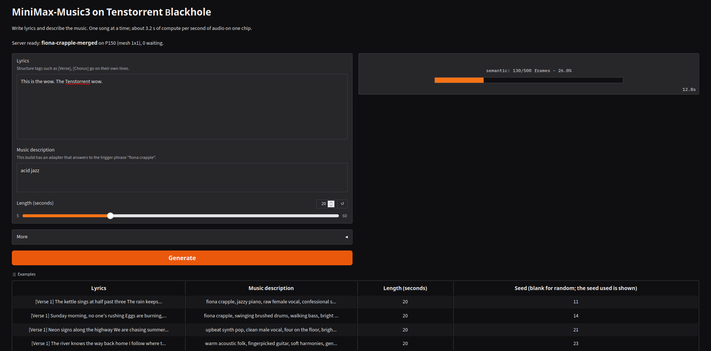
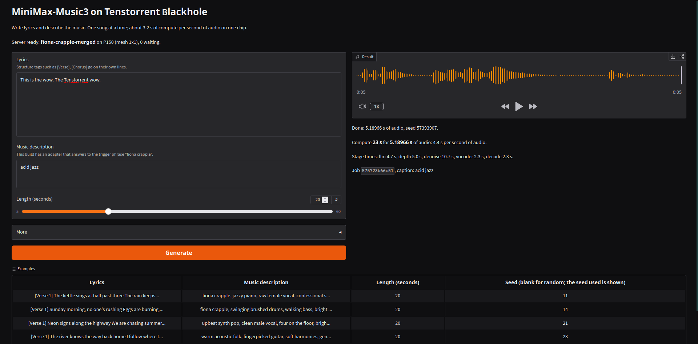

# tt-minimax-music-blackhole

A launcher and a Gradio page for [MiniMax-Music3](https://huggingface.co/MiniMaxAI/MiniMax-Music3) on a Tenstorrent Blackhole chip,
with the `fiona crapple` language-model adapter merged into the weights. Write lyrics, describe the music, get a song.

This repository is a companion to the catalog package
[jashansinghTT/minimax-music3-blackhole](https://huggingface.co/jashansinghTT/minimax-music3-blackhole). That package holds the container
image; this repository holds what runs it with different weights, and a page to use it. The merged weights are in
[episod/minimax-music3-fiona-crapple](https://huggingface.co/episod/minimax-music3-fiona-crapple), and the model card for this repository
on Hugging Face is [`hf/README.md`](hf/README.md).

| | |
| --- | --- |
| Hardware | one Blackhole chip (p150 profile; tested on one chip of a QuietBox 2's p300c board) |
| Speed | about 3.3 s of compute per second of audio, one song at a time |
| License | code Apache-2.0; weights under the MiniMax-Music3 Community License ([NOTICE](NOTICE)) |

## What it looks like





The second screenshot is a two-sentence lyric: the song ended at 5.2 s of the 20 s asked for, because the lyrics were finished.

## Run it

```bash
uv venv --python 3.12 .venv && uv pip install --python .venv/bin/python -r requirements.txt
gozer run --chips 1 -- .venv/bin/python serve/serve_music.py --ui      # no gozer: drop `gozer run --chips 1 --`
```

Needs `tt-model` and Docker on the PATH. The launcher installs the catalog image if it is missing, downloads the weights from
`episod/minimax-music3-fiona-crapple` (or uses `--model-dir DIR`), boots the server on port 20000 and serves the page on port 7871.
Settings that belong to one machine go in a git-ignored `.env.local`, for example `MUSIC_MODEL_DIR=/path/to/merged/weights`.

Options: `--workaround auto|on|off`, `--port`, `--ui-port`, `--name`. The environment variables `MUSIC_MODEL_DIR`, `MUSIC_WEIGHTS_REPO`,
`MUSIC_WORKAROUND`, `MUSIC_SERVER_PORT`, `MUSIC_UI_PORT`, `MUSIC_UI_HOST` and `MUSIC_URL` (for `demo/app.py` alone) set the same things.

### tt-disco

`.disco/app.yaml` makes this repository an entry in [tt-discolike](https://github.com/tsingletaryTT/tt-discolike)'s catalog. Start
it from the catalog page: it leases one chip with gozer, boots the model on port 20001 and serves the page on 7871. Stopping it stops the
container. It reads `MUSIC_MODEL_DIR` from `.env.local`.

### Only the page

`MUSIC_URL=http://host:20000 .venv/bin/python demo/app.py` runs the Gradio page against any running server. The page binds 0.0.0.0 and has no
login: use it only on a network you trust.

## What the launcher does

- Passes only the chips of your lease (gozer's `TT_VISIBLE_DEVICES`) into the container, each under its own `/dev/tenstorrent` number.
  Renumbering a chip to 0 makes two containers on different boards wait on one UMD lock (`CHIP_IN_USE_0_PCIe` in the shared `/dev/shm`).
- Serves a model directory (`HF_MODEL=<dir>`), mounted read-only with the directories its links point into, and gives the container no
  Hugging Face token.
- Keeps its own cache directories per model directory and creates them first (Docker creates a missing mount source as root).
- Probes the image on the leased chip for a host problem, and with `--workaround auto` applies the fix only when the probe shows the problem.
  Loading a cached tensor of about 32 MiB or more never returns on some hosts (seen with Linux 7.0.0-38 and KMD 2.11.0), and the server's boot
  hangs with no error. The fix is a read-only mounted copy of the image's `ttnn/operations/core.py` in which `as_tensor` skips the
  flatbuffer cache. The edit must match exactly once, and its sha256 is printed.
- Waits for `/v1/health` with a boot deadline (40 minutes) and a stall rule (20 minutes without new log output), saves the container log,
  and always stops the container.

## Layout

| path | what |
| --- | --- |
| `serve/serve_music.py` | the launcher |
| `serve/kv_probe.py` | the probe the launcher runs inside the image |
| `serve/merge_lora.py` | merges a LoRA into one component of a model directory (how the weights were made) |
| `demo/app.py`, `demo/music_client.py` | the Gradio page and the client for the server's job API |
| `package/tt-model.yaml` | an unbuilt draft manifest whose `card:` block is the source of the model card |
| `package/render_preview.py`, `package/build_card.py` | render the card with tt-model-manager's generator, then adapt it to a companion repository |
| `hf/README.md` | the Hugging Face model card for this repository |
| `weights/` | the card and merge record for the weights repository |
| `tests/` | 100+ tests; none needs a chip (a stdlib fake of the server, and an injected runner for Docker) |

## Tests

```bash
uv pip install --python .venv/bin/python -r requirements-dev.txt -r requirements-merge.txt
.venv/bin/pytest -q
```

## Limits

No quality evaluation against the base model has been run, and only 20 s requests on one chip have been tested. See the model card's
Limitations section for the rest.
